

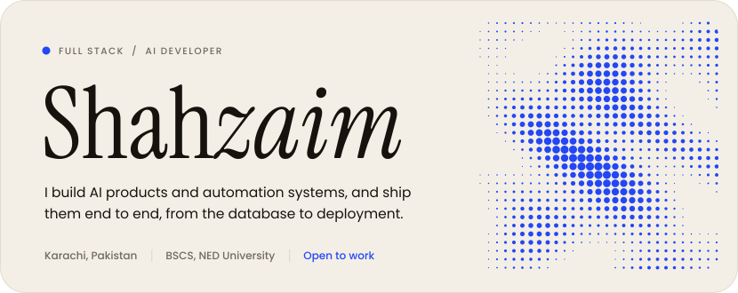

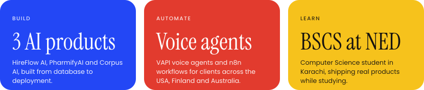

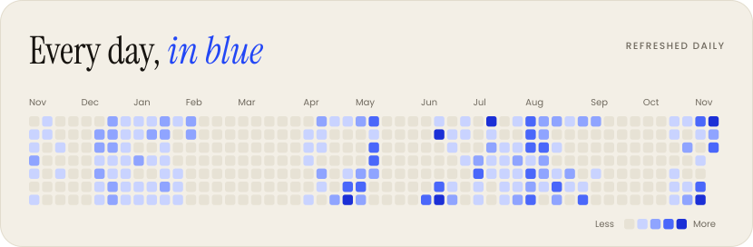

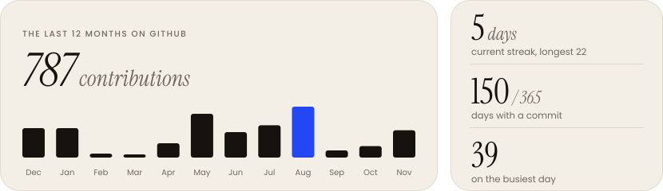

<a href="https://shahzaim.vercel.app/projects">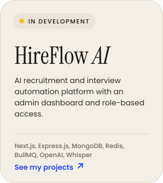</a>
<a href="https://pharmify-ai.vercel.app/">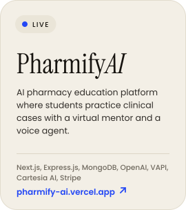</a>
<a href="https://corpusai.vercel.app/">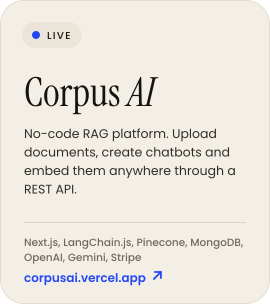</a>

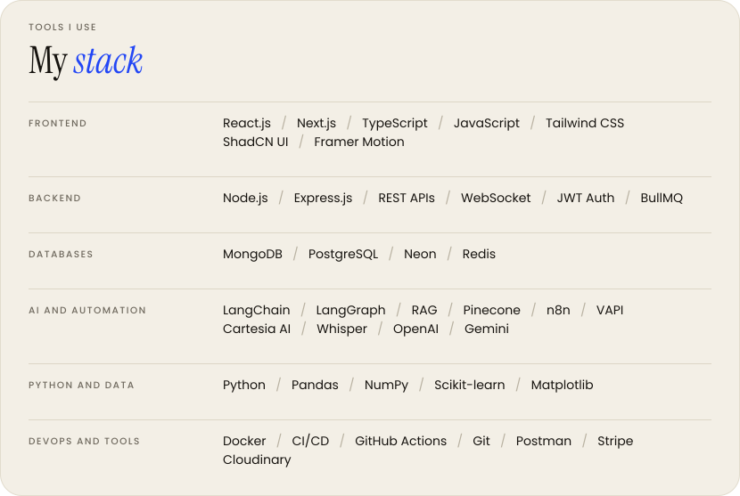

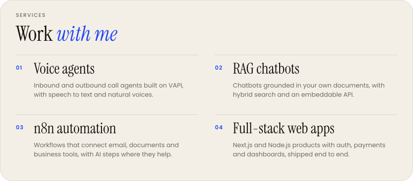

<a href="https://www.linkedin.com/in/shahzaim/">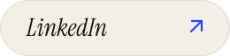</a>
<a href="https://github.com/Shahzaim84">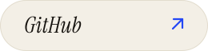</a>

